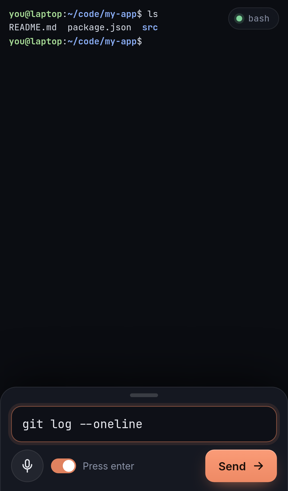
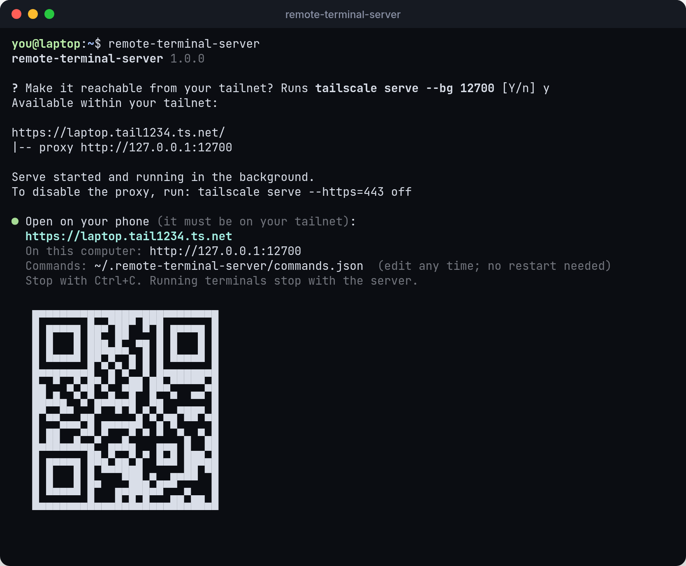

# Remote Terminal

Use the terminals on your computer from your phone's browser: a shell, Claude Code, Codex, Cursor Agent, anything. It runs over [Tailscale](https://tailscale.com), so only your own devices can reach it.

<p align="center">
  
  
  
</p>

## Install

```bash
curl -fsSL https://raw.githubusercontent.com/naiemk/remote-terminal/main/install.sh | bash
remote-terminal-server
```

Linux and macOS. The installer uses your Node.js 18.17+ or downloads its own copy. On Linux it needs a C++ compiler, `make` and `python3`.

On the first run, `remote-terminal-server` checks for Tailscale, offers to run `tailscale serve` for you, and prints the address to open on your phone, with a QR code. Without Tailscale it still runs, but only this computer can open it.

<p align="center"></p>

## Upgrade

```bash
remote-terminal-server update
```

This runs the installer again and fetches the latest version. Your settings in `~/.remote-terminal-server/` (`commands.json`, `.env`) are kept.

Then **restart the server** so it picks up the new code: stop the running `remote-terminal-server` (Ctrl+C, or stop the service if you [keep it running](docs/guides/keep-running.md)) and start it again. Running terminals end when the server stops. Reload the page on your phone afterwards.

If `update` isn't available (an older install), run the install command above again; it does the same thing. Check the installed version with `remote-terminal-server doctor`.

## Documentation

**[naiemk.gitbook.io/remote-terminal](https://naiemk.gitbook.io/remote-terminal)** (source in [`docs/`](docs/README.md))

* [Install](docs/getting-started/install.md) · [Set up Tailscale](docs/getting-started/tailscale.md) · [Connect from your phone](docs/getting-started/connect.md)
* [Using the console](docs/guides/console.md) · [Commands](docs/guides/commands.md) · [Keep it running](docs/guides/keep-running.md)
* [CLI](docs/reference/cli.md) · [Configuration](docs/reference/configuration.md) · [Security](docs/reference/security.md) · [Troubleshooting](docs/reference/troubleshooting.md)

## What you get

* **Smooth scrolling** with your finger, trackpad or wheel, with momentum, like a native app.
* **Text selection on the phone:** tap a word, triple-tap a paragraph, drag the handles, copy.
* **A menu per terminal:** it shows what's running now (`cursor-agent`, not the `bash` it was started from) and where, and lets you switch between terminals.
* **Files between you and your agents:** each terminal has a scratch folder (`$REMOTE_TERM_SCRATCH`). Upload, download and copy its path from the browser.

## Commands

The **Start** buttons come from `~/.remote-terminal-server/commands.json`. Edit it with `remote-terminal-server edit`. Changes show up without a restart.

```json
{
  "bash": "bash",
  "claude": "claude",
  "codex": "codex",
  "api": { "cmd": "npm run dev", "cwd": "~/code/api" }
}
```

## Security

There's no password. The server only listens on `127.0.0.1`, and `tailscale serve` (tailnet only) is the only way in. Never expose it with `tailscale funnel`. See [Security](docs/reference/security.md).

## Development

```bash
npm install
npm start                 # ./bin/remote-terminal-server
npm run check             # syntax check
npm run screenshots       # regenerate docs/images (needs Chromium)
```

* `bin/remote-terminal-server`: the CLI, including Tailscale detection and the first-run setup.
* `server/`: serves the web client, starts commands in PTYs, and relays each one to any number of browsers. It keeps 512 KB of output per terminal for viewers who join later.
* `public/`: the web client, built on xterm.js.
* `install.sh`: the `curl | bash` installer.
* `docs/`: the GitBook site. `.github/workflows/docs.yml` publishes it on every push to `main`.
