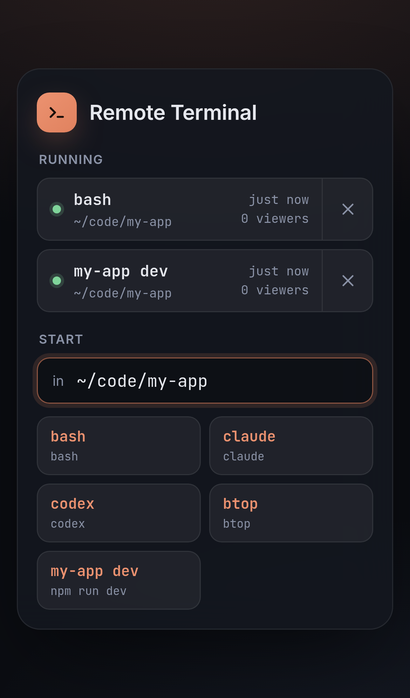
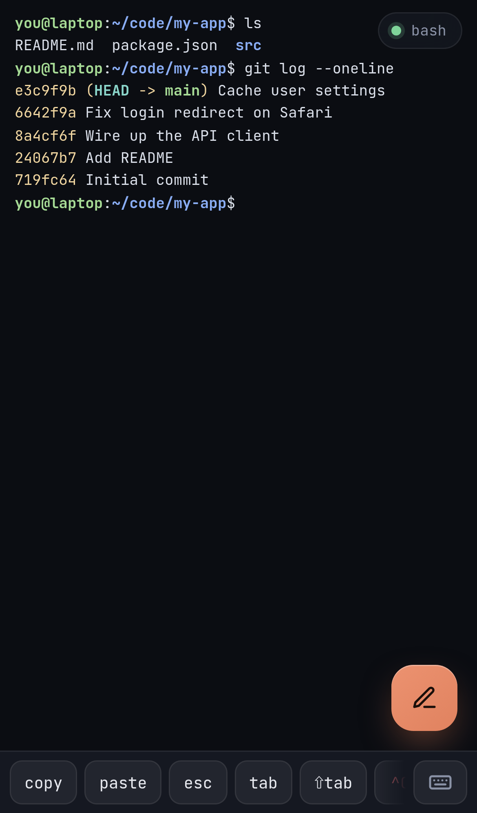

# Remote Terminal

Remote Terminal lets you open terminals on your computer from your phone's browser: a shell, Claude Code, Codex, Cursor Agent, `btop`, anything that runs in a terminal. You start a program on the phone, walk away, and pick it up again from your laptop or another browser. Everyone who opens it sees the same screen.

<div align="center"> </div>

## How it works

```
 phone browser ──▶ tailscale serve (HTTPS, tailnet only) ──▶ remote-terminal-server on 127.0.0.1:12700 ──▶ bash, claude, …
```

* **`remote-terminal-server`** runs on your computer. It starts the programs listed in `~/.remote-terminal-server/commands.json` in real terminals (PTYs) and streams them to any number of browsers.
* It only listens on `127.0.0.1`. It is reachable only through [Tailscale](https://tailscale.com), so only your own devices can connect, over HTTPS with a valid certificate.
* The web console is made for phones: a key bar (esc, tab, ^C, arrows…), a compose box you can type or dictate into, and copy and paste that work on touch screens.

## Quick start

```bash
curl -fsSL https://raw.githubusercontent.com/naiemk/remote-terminal/main/install.sh | bash
remote-terminal-server
```

The first run offers to set up `tailscale serve` for you and prints the address to open on your phone, with a QR code.


No Tailscale yet? The server still runs, but only this computer can open it. [Set up Tailscale](getting-started/tailscale.md) when you want to use it from your phone.


## Next steps

* [Install](getting-started/install.md) on Linux or macOS
* [Set up Tailscale](getting-started/tailscale.md) and find your machine's address
* [Connect from your phone](getting-started/connect.md)
* [Choose which programs you can start](guides/commands.md)
