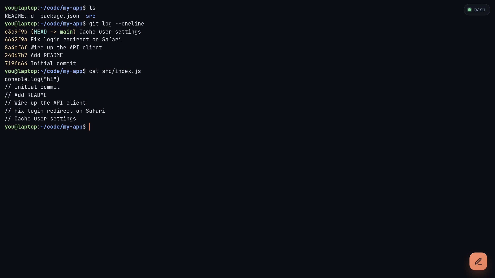

# Connect from your phone

1. Make sure Tailscale is **connected** on the phone (the toggle in the Tailscale app).
2. Scan the QR code that `remote-terminal-server` printed, or type the address, for example `https://laptop.tail1234.ts.net`.
3. The home page lists the terminals that are running and the commands you can start.

Tap a command under **Start** to open a new terminal. Tap one under **Running** to join it. See [Using the console](../guides/console.md) for the rest.

## Add it to your home screen

The console works best full screen:

* **iPhone (Safari):** Share → **Add to Home Screen**.
* **Android (Chrome):** ⋮ → **Add to Home screen** (or **Install app**).

## On another computer

Any browser on any device in your tailnet works, at the same address. On the computer running the server, you can also use `http://127.0.0.1:12700`.

## It doesn't load?

* Check that `remote-terminal-server` is still running on the computer.
* Check that the phone shows as connected in `tailscale status`.
* Run `remote-terminal-server doctor` on the computer.

More in [Troubleshooting](../reference/troubleshooting.md).
