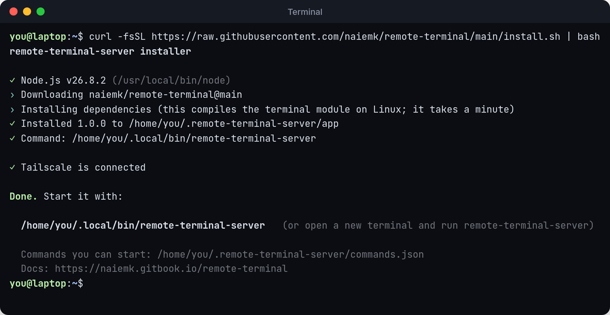

# Install

```bash
curl -fsSL https://raw.githubusercontent.com/naiemk/remote-terminal/main/install.sh | bash
```



The installer:

1. Uses your Node.js if it's version 18.17 or newer. If not, it downloads a private copy of Node.js 22 into `~/.remote-terminal-server/node`. Your system's Node.js isn't changed.
2. Downloads Remote Terminal into `~/.remote-terminal-server/app` and installs its dependencies.
3. Adds the `remote-terminal-server` command to `~/.local/bin`. If that folder isn't on your `PATH`, it adds it in your shell profile (`~/.bashrc`, `~/.zshrc` or fish's `config.fish`).
4. Checks for Tailscale. It isn't required to install, and the server runs without it. See [Set up Tailscale](tailscale.md).

Open a new terminal (or run the full path it prints), then start the server:

```bash
remote-terminal-server
```

## Requirements

| | |
| --- | --- |
| **System** | Linux or macOS (Intel or Apple silicon). Windows isn't supported. |
| **Node.js** | 18.17 or newer, or none: the installer can download it. |
| **Linux only** | A C++ compiler, `make` and `python3`, to build the terminal module. On macOS it comes prebuilt. |

If the build tools are missing, the installer stops and prints the command for your distribution, for example:



```bash
sudo apt-get install -y build-essential python3
```



```bash
sudo dnf install -y make gcc-c++ python3
```



```bash
sudo pacman -S --needed base-devel python
```



## Update

```bash
remote-terminal-server update
```

This runs the installer again. Your settings in `~/.remote-terminal-server/` (`commands.json`, `.env`) are kept.

## Install options

Set these before `bash` in the install command, for example `curl -fsSL … | REMOTE_TERMINAL_REF=v1.0.0 bash`.

| Variable | Default | |
| --- | --- | --- |
| `REMOTE_TERMINAL_REF` | `main` | Branch or tag to install |
| `REMOTE_TERMINAL_HOME` | `~/.remote-terminal-server` | Where the app and settings live |
| `REMOTE_TERMINAL_BIN_DIR` | `~/.local/bin` | Where the command goes |
| `REMOTE_TERMINAL_NO_MODIFY_PATH` | | Set to `1` to leave your shell profile alone |
| `REMOTE_TERMINAL_NODE` | | Path to a specific `node` to use |
| `REMOTE_TERMINAL_SOURCE` | | Install from a local checkout or `.tgz` instead of GitHub |

## From source

```bash
git clone https://github.com/naiemk/remote-terminal.git
cd remote-terminal
npm install
npm start            # same as ./bin/remote-terminal-server
```

## Uninstall

```bash
rm -rf ~/.remote-terminal-server ~/.local/bin/remote-terminal-server
tailscale serve reset   # only if nothing else on this machine uses tailscale serve
```

Keep `~/.remote-terminal-server/commands.json` if you might come back.
