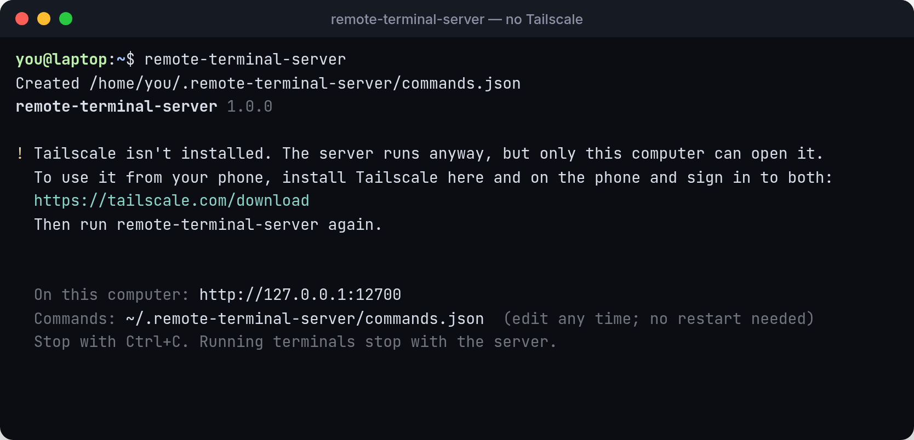
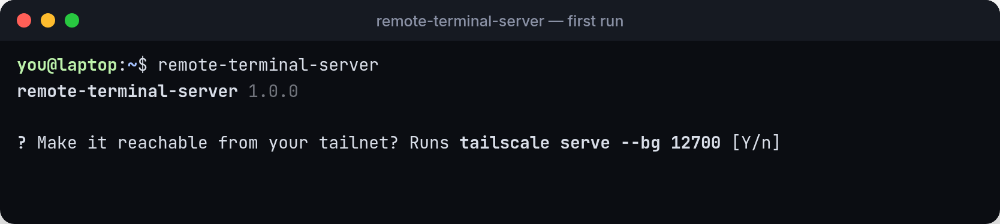
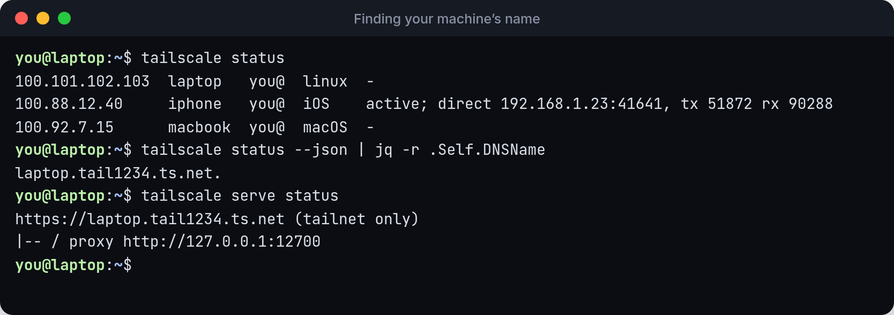

# Set up Tailscale

Remote Terminal never listens on your network. Your phone reaches it through [Tailscale](https://tailscale.com), a private network (a *tailnet*) between your own devices. Tailscale is free for personal use.

## 1. Install Tailscale on both devices

* **This computer:** [tailscale.com/download](https://tailscale.com/download). On Linux it's usually `curl -fsSL https://tailscale.com/install.sh | sh` followed by `sudo tailscale up`.
* **Your phone:** the Tailscale app from the App Store or Google Play.

Sign in to both with the **same account**, so they're on the same tailnet.

If Tailscale isn't installed, `remote-terminal-server` says so and keeps running. Only this computer can open it until you finish this page:



## 2. Turn on MagicDNS and HTTPS

Both are on by default for new tailnets. To check, open the [DNS page](https://login.tailscale.com/admin/dns) of the Tailscale admin console:

* **MagicDNS** gives every device a name like `laptop.tail1234.ts.net`.
* **HTTPS Certificates** lets Tailscale give that name a real certificate.

## 3. Let `remote-terminal-server` set up `tailscale serve`

Run the server. If Tailscale is connected but not yet forwarding to it, it asks once:



Press **Enter**. It runs `tailscale serve --bg 12700`, which Tailscale remembers across reboots, and prints your address and a QR code:



**Linux: "Access denied: serve config denied"?** Allow your user to change Tailscale's settings once, then run the server again:

```bash
sudo tailscale set --operator=$USER
```



**First time using Serve?** Tailscale may print a link to enable it for your tailnet, and wait. Open the link, approve, and it carries on.


If `https://<machine>.ts.net/` already forwards to something else, `remote-terminal-server` doesn't replace it. It uses another HTTPS port, such as `:8443`, and prints that address.

To set it up yourself instead, or after using `--no-serve`:

```bash
tailscale serve --bg 12700
```

## Find your machine's address

`remote-terminal-server` prints it at startup. You can also ask Tailscale:



* `tailscale status` lists the devices on your tailnet. Your phone should be there.
* `tailscale status --json | jq -r .Self.DNSName` prints this machine's full name (ignore the trailing dot).
* `tailscale serve status` shows what's being served. You want `(tailnet only)` and `proxy http://127.0.0.1:12700`.

The name is also on the [Machines page](https://login.tailscale.com/admin/machines) of the admin console. Click the machine and look for **Full domain**, or open the Tailscale app on your phone and tap the machine.


Never use `tailscale funnel` for Remote Terminal. Funnel puts the service on the public internet, and anyone could get a shell on your computer. `remote-terminal-server` warns you if it detects Funnel. Turn it off with `tailscale funnel reset`.


Next: [Connect from your phone](connect.md).
