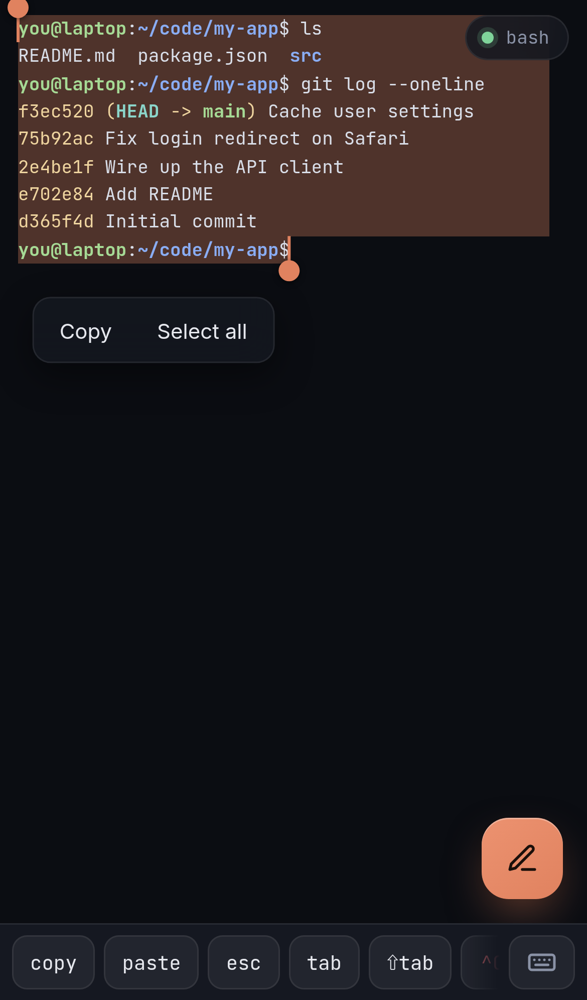
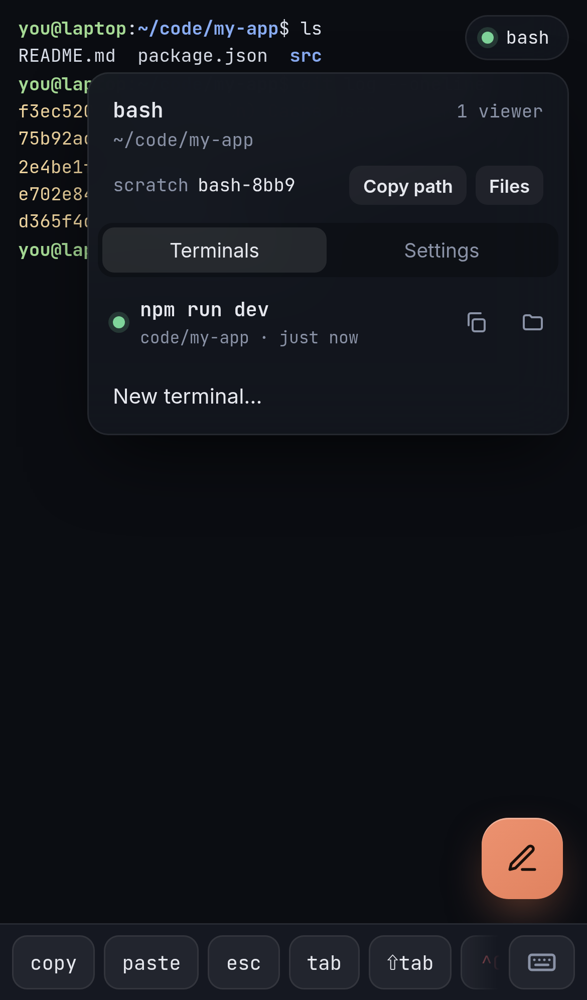
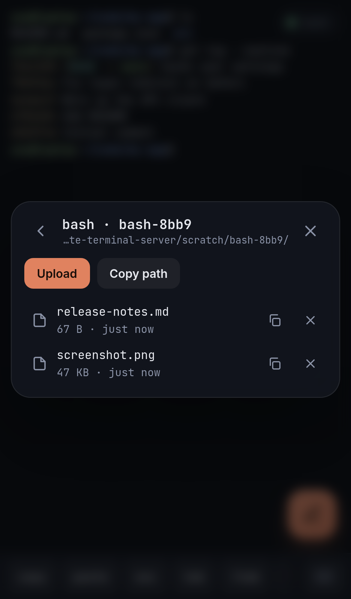

# Using the console

## Home

**Running** lists the terminals that are open on the computer, with their folder, age and number of viewers.

* Tap one to join it.
* Tap **×**, then **Kill?** to close it. The program gets `SIGHUP`, then `SIGKILL` after 3 seconds.

**Start** opens a new terminal with one of the [commands](commands.md).

* **in** sets the folder it starts in, for example `~/code/my-app`. Leave it empty to use the command's own `cwd`, or your home folder.
* You can run any number of terminals, including several of the same command.

Terminals belong to the server, not to the browser. Close the tab, lock the phone or lose signal, and the program keeps running. Join it again from Home.

## The terminal

* **Scroll** with your finger, the trackpad or the mouse wheel, like any page: it moves smoothly and keeps gliding after a flick. When new output arrives while you're scrolled back, the view stays put. Typing or scrolling to the end takes you back to the live bottom. In full-screen apps that have no history of their own (`less`, `vim`, Codex), the same gesture scrolls inside the app.
* The **key bar** along the bottom has the keys a phone keyboard lacks: `esc`, `tab`, `⇧tab`, `^C`, the arrows, `⏎`, `^D`, `^L`, `pgup` and `pgdn`. Swipe it sideways for more.
* Tapping the terminal doesn't open the phone keyboard. Tap **⌨** at the end of the key bar to type straight into the terminal.

## Compose: type or dictate

The pencil button opens the compose box. It's the comfortable way to write a prompt for Claude Code or a long command:

* The phone's own keyboard, autocorrect and dictation all work here. Tap the 🎙 button to dictate where the browser supports it.
* **Send** types the text into the terminal. With **Press enter** on, it presses Enter afterwards.
* Text with several lines is sent as one paste, so Claude Code takes it as a single prompt.
* On a computer: **Ctrl/Cmd+K** opens it, **Enter** sends, **Shift+Enter** adds a new line.

## Select and copy text

**On a phone**

* **Tap** a word to select it. Paths and URLs count as one word.
* **Tap three times** to select the whole paragraph: the lines around it, up to a blank line.
* **Drag the handles** at either end to change the selection. Hold a handle near the top or bottom edge, and the terminal scrolls so you can select more than one screen.
* Tap **Copy** in the bar above the selection, or **Select all** for the whole history. Tap empty space to dismiss it.

**On a computer**

* Drag to select, double-click a word, triple-click a paragraph. Copy with **Ctrl+Shift+C** (or **Cmd+C**).

## The menu

Tap the status pill in the top-right corner. It shows the program running in the terminal right now: open `bash` and start `cursor-agent` in it, and it says `cursor-agent`. The browser tab's title shows the same, with the last two folders of where it runs (`cursor-agent · nk/api`).

The top of the menu is about this terminal: the program, its folder, the number of viewers and its [scratch folder](#files-pass-files-to-and-between-agents), with **Copy path** and **Files**.

**Terminals** lists the other running terminals. Tap one to switch to it. Next to each are buttons to copy its scratch path and to open its files. **New terminal…** goes to the home page.

**Settings**:

| | |
| --- | --- |
| **Font size** | Bigger or smaller text. Saved per browser. |
| **Home** | Back to the home page. The terminal keeps running. |
| **Show key bar** | Hide the key bar for more room. |
| **Fullscreen** | Hide the browser's toolbars. |
| **Copy text…** | Open the terminal's text for selecting and copying. |
| **Paste** | Send the clipboard to the terminal. |
| **Redraw screen** | Ask the program to repaint if the screen looks wrong. |

## Files: pass files to and between agents

Every terminal gets its own scratch folder in `~/.remote-terminal-server/scratch/`, named after the command (for example `claude-3f9a`). The programs in the terminal find it in **`$REMOTE_TERM_SCRATCH`**.

* **From your phone to an agent:** open **Files** from the menu, tap **Upload**, then tell the agent to look in `$REMOTE_TERM_SCRATCH`, or tap **Copy path** and paste the path into your prompt.
* **From an agent to your phone:** ask it to save the file in `$REMOTE_TERM_SCRATCH`, then tap it under **Files** to download it.
* **Between agents:** copy one terminal's scratch path (from the **Terminals** tab) and give it to another agent. Or upload into **Shared scratch**, the top folder, which you open from **Files** on the home page.

Files stay after a terminal ends, and you can delete them with ×. Empty folders are removed when their terminal ends.

## Copy and paste

**On a phone**

* **copy** in the key bar opens the terminal's text in a plain view. Long-press to select and use the system's Copy, or tap **Copy all**. It holds the whole scrollback for a shell, and the current screen for full-screen apps.
* **paste** in the key bar sends the clipboard to the terminal. If the browser won't share the clipboard, the compose box opens so you can paste there.

**On a computer**

* Paste with **Ctrl+Shift+V** (or **Cmd+V**).
* When a program captures the mouse, as Claude Code does, hold **Shift** (or **Option** on a Mac) while dragging.

## Several viewers

Open the same terminal on your phone and your laptop at once, and both show the same screen. The terminal's size follows whichever one typed or resized last.

## Extras

* Add `?webgl` to the address to use the GPU renderer, which can be faster for busy full-screen apps.
